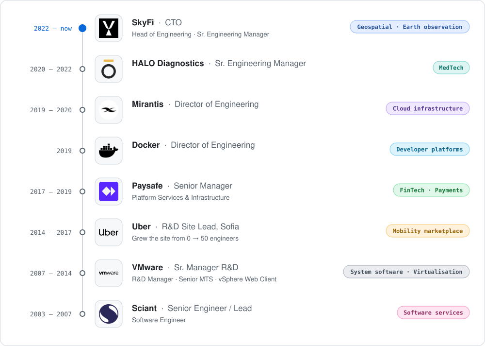

<picture>
  <source media="(prefers-color-scheme: dark)" srcset="assets/banner-dark.svg">
  
</picture>

I build the engineering organisations behind complex systems people depend on — today, the Earth intelligence platform at [SkyFi](https://skyfi.com), making satellite imagery and geospatial analytics accessible. 20+ years in technology leadership, and still an engineer at heart.

### 01 · What I work on

<table>
  <tr><td><b>Layers</b></td><td>UI · Backend · Infrastructure · AI & ML</td></tr>
  <tr><td><b>Domains</b></td><td>Earth observation · Payments · Finance · Tax & compliance · SaaS · Developer platforms · Virtualisation</td></tr>
  <tr><td><b>Tech</b></td><td>Java · Python · Go · JavaScript · Kubernetes · a long tail of things — most recently AI</td></tr>
</table>

### 02 · How I lead

1. **Ownership** — you build it, you run it.
2. **Proactiveness** — don't wait to be told.
3. **Agility** — respond to change over following a plan.
4. **Courage** — speak truth to power.
5. **Speed** — speed is a feature.
6. **Embracing AI** — augment your intelligence.

### 03 · Path

<picture>
  <source media="(prefers-color-scheme: dark)" srcset="assets/career-dark.svg">
  
</picture>

### 04 · Say hi

Open to advisory and board work, speaking, and conversations with engineering leaders.

[juliansirakov.com](https://juliansirakov.com) · [LinkedIn](https://www.linkedin.com/in/juliansirakov/)
